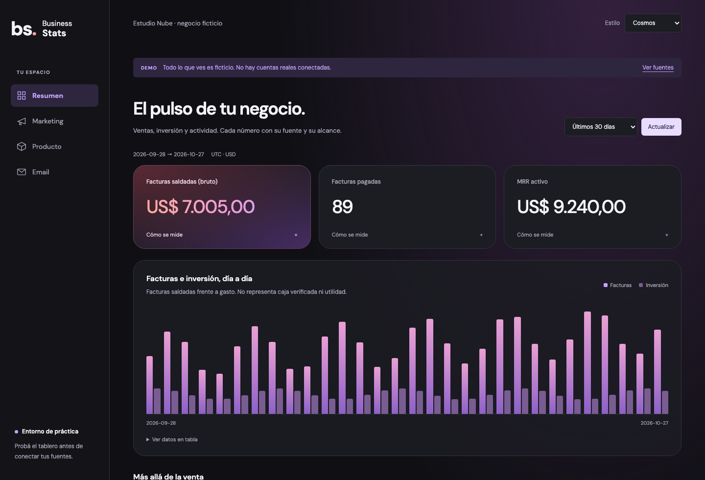
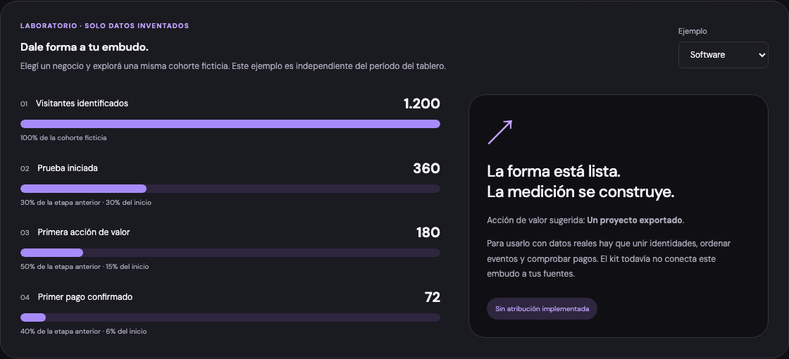

# Business Stats Kit

**Tu negocio, tus datos, tu dashboard.** Una plantilla para construir un tablero privado de ventas, marketing, producto y email con ayuda de Claude Code o Codex.

Trae cinco diseños, ejemplos ficticios, acceso con contraseña y passkey, siete skills y cuatro roles de agente. Cada persona crea su propia copia y conecta sus propias fuentes.

[Empezar con el agente](#empezar-con-claude-code-o-codex) · [Probar la demo](#probar-la-demo) · [Guía de construcción](docs/build-guide.md) · [Diseños](docs/designs.md) · [Seguridad](docs/security.md)



*Cosmos, inspirado en el panel del instructor. Todos los números de las imágenes pertenecen a un negocio ficticio; no son resultados prometidos ni datos de Claudio.*

## Qué vas a poder construir

Un lugar para responder preguntas concretas: qué facturas se saldaron, cuánto invertiste, qué acciones de valor hicieron tus clientes y cuántos mensajes entregados recibieron clics. Cada métrica conserva su fuente, período, alcance y cobertura.

| Incluido y funcional | Qué necesita tu configuración | Qué requiere desarrollo adicional |
|---|---|---|
| Demo, cinco estilos y cuatro secciones | Nombre, moneda, zona y una oferta inicial | Multiempresa o equipos con permisos |
| Contraseña + passkey, un dueño | Postgres dedicado, origen y alta privada | Segunda passkey independiente y recuperación autoservicio |
| Lectura Stripe y Meta | Claves de lectura, IDs y conciliación | Mercado Pago, Hotmart, Google Ads u otras fuentes |
| Producto/email por JSON; consulta manual PostHog | Exportación completa y eventos canónicos | Sincronización nativa Resend, recordatorios y avisos de ventas |
| Embudos **visuales ficticios**, solo en demo | Elegir las etapas de tu negocio | Unión real anuncio→visita→pago y envío de conversiones |

**No reemplaza UTMify de forma completa.** El kit no implementa atribución por anuncio ni envío de conversiones. [Comparación y condiciones para decidir](docs/utmify.md).

Stripe mide facturas saldadas y MRR nominal del catálogo: no representa caja bancaria ni beneficio, y no descuenta comisiones/reembolsos. Un proveedor que falla aparece como no disponible; no se convierte en cero. [Definiciones y límites](docs/metrics.md).

## Empezar con Claude Code o Codex

Copiá este mensaje en un agente con acceso a archivos y terminal:

> Quiero instalar https://github.com/condeclaudioad/business-stats-kit para mi negocio. Si ya tengo una copia, preservala; si no, prepará una copia propia. Leé AGENTS.md y seguí docs/build-guide.md con stats-onboarding. Primero demo y diseño; después una oferta, fuentes y métricas definidas, acceso privado y una fuente conciliada. No me pidas secretos en el chat. Guardá avances privados fuera de Git y distinguí implementado, conectado y verificado. No publiques hasta que haya elegido y autorizado el destino.

El agente guía y ejecuta lo que su entorno permite. Vos elegís el negocio, ingresás credenciales en privado y completás la passkey. Pegar el enlace en un chat sin herramientas no instala la aplicación.

### El orden de construcción

| Paso | Resultado que debe comprobar el agente |
|---|---|
| 1. Copia propia y entorno | Carpeta correcta, cambios existentes preservados y dependencias instaladas |
| 2. Demo | Abre localmente, muestra etiqueta ficticia y permite navegar |
| 3. Una oferta y un diseño | Ficha del negocio, definiciones y apariencia elegida |
| 4. Adaptaciones necesarias | Fuentes clasificadas; conectores faltantes probados con fixtures antes de usar cuentas |
| 5. Base y acceso privado | Origen elegido, esquema dedicado y contraseña + passkey; API rechaza acceso anónimo |
| 6. Una fuente por vez | Permiso mínimo, alcance explícito y un período conciliado contra el origen |
| 7. Publicación y operación | Pruebas en el dominio final, recuperación, backups y responsable de mantenimiento |

La [guía de construcción](docs/build-guide.md) detalla comandos, evidencias, dependencias y cómo retomar una instalación existente. Si se elige el dominio remoto desde el principio, explica cuándo publicar la instalación vacía y registrar la passkey antes de conectar fuentes. No existe un botón que conecte todas tus cuentas automáticamente.

## Probar la demo

Necesitás Git, Node.js **22.22 o 24** y npm. No necesitás cuentas Stripe/Meta, base de datos ni claves para probarla.

1. En este repo, elegí **Use this template → Create a new repository**. Creá tu copia, preferentemente privada para la adaptación de tu negocio.
2. Cloná **tu copia**, no el repositorio del instructor como destino de tus cambios. En la terminal, reemplazá `URL_DE_TU_COPIA` por la URL que muestra GitHub:

```bash
git clone URL_DE_TU_COPIA mi-dashboard
cd mi-dashboard
npm ci
npm run demo:setup
npm run doctor
npm run dev
```

3. Abrí **[http://localhost:4321](http://localhost:4321)**. Debe aparecer la etiqueta **DEMO** y datos inventados. Cambiá el estilo, la sección y el período. Para detener el servidor, usá `Ctrl+C`.

`demo:setup` conserva un `.env.local` existente. Si estás retomando una instalación live, no la cambies a demo ni reemplaces sus credenciales: seguí la guía de construcción. `doctor` comprueba configuración; no certifica permisos de proveedores ni seguridad en producción.

## Elegí el diseño

Todos usan los mismos contratos y controles de acceso. Cambiar la apariencia no cambia las fórmulas.

| Estilo | Aspecto y uso |
|---|---|
| [Cosmos](docs/images/cosmos.png) | Grafito, vidrio y acento rojo/violeta, inspirado en el panel del instructor |
| [Executive](docs/images/executive.png) | Navegación superior y distribución compacta |
| [Studio](docs/images/studio.png) | Claro, verde y navegación lateral |
| [Editorial](docs/images/editorial.png) | Papel, serif y presentación de informe |
| [Terminal](docs/images/terminal.png) | Oscuro, monoespaciado y acentos verdes |

En **Resumen**, la demo también permite explorar embudos de software, curso/PDF y servicios:



*El laboratorio usa una cohorte inventada, independiente del período del tablero. Nunca aparece como medición real en modo live.*

[Galería y archivos para personalizar](docs/designs.md) · [Receta SaaS](docs/recipes/saas.md) · [Curso](docs/recipes/course.md) · [PDF](docs/recipes/pdf.md) · [Servicios](docs/recipes/services.md).

## Agentes y skills: qué hace cada uno

| Skill | Para qué usarla |
|---|---|
| `stats-onboarding` | Instalar, definir el negocio y coordinar el recorrido |
| `stats-design` | Adaptar la apariencia con pruebas responsive |
| `stats-connect-sources` | Configurar fuentes ya soportadas |
| `stats-adapter` | Construir una integración o métrica que todavía falta |
| `stats-reconcile` | Explicar y corregir diferencias contra el proveedor |
| `stats-security` | Revisar acceso y preparar/verificar una publicación |
| `stats-maintenance` | Diagnosticar fallos, cobertura, cuotas y cambios de API |

La fuente común está en `.agents/skills/`; los enlaces de `.claude/skills/` permiten compartirla. Si tu cliente no los reconoce, pedile leer el `SKILL.md` explícitamente. No hace falta instalar skills globales.

También hay cuatro roles: implementación, revisión de datos, revisión de acceso y revisión de diseño. Claude tiene definiciones en `.claude/agents/`; Codex dispone de encargos portables en `.agents/briefs/`, que el coordinador usa con las herramientas disponibles. **No se activan automáticamente por existir esos archivos.** [Prompts y funcionamiento](docs/agents.md).

## Acceso y datos reales

La [guía de construcción](docs/build-guide.md) conecta el procedimiento de [seguridad](docs/security.md), las [integraciones](docs/integrations.md) y la [publicación en Vercel](docs/deploy-vercel.md).

- Las claves viven en el servidor; nunca en el chat, el frontend ni un commit.
- La contraseña sola no habilita el dashboard live: también se verifica la passkey. El servidor no recibe tu huella ni tu cara.
- Una instalación tiene un dueño. No hay registro público; la recuperación administrativa revoca sesiones y passkeys anteriores.
- La cobertura parcial se muestra como tal. Un archivo de siete días no acredita noventa días completos.
- No hay refresco automático cada 15 segundos. Stripe/Meta reutilizan lecturas hasta 60 segundos por proceso.

La seguridad también depende de permisos, infraestructura y mantenimiento. Un build exitoso no demuestra que tu dominio esté protegido ni que tus cifras estén conciliadas.

## Comprobar los cambios

Desde la raíz del proyecto:

```bash
npm test
npm run typecheck
npm run build
npx playwright install chromium
npm run test:browser
```

Las pruebas de base se omiten sin configuración específica. Usá bases **descartables**: `AUTH_TEST_DATABASE_URL` termina en `_auth_test`, `TEST_DATABASE_URL` en `_import_test`. Las pruebas de navegador usan puertos locales 4335/4336; WebAuthn requiere `E2E_DATABASE_URL` local, sin parámetros adicionales y con base terminada en `_e2e_test`. **Esas pruebas modifican o resetean las bases de prueba: nunca apuntarlas a una instalación real.**

La CI ejecuta las pruebas con bases desechables, build y navegador con autenticador virtual. [Resultados y límites verificados](docs/verification.md) · [Ejecuciones de GitHub](https://github.com/condeclaudioad/business-stats-kit/actions).

## Material y mapa del proyecto

| Buscás | Archivo o guía |
|---|---|
| Nombre, moneda, zona y alcance | `business.config.ts` |
| Interfaz y ejemplos visuales | `app/Dashboard.tsx`, `app/DemoFunnel.tsx`, `app/globals.css` |
| Acceso privado | `lib/auth/`, `sql/auth.sql` |
| Lectura de proveedores | `lib/provider-connectors.ts` |
| Eventos e importación | `db/analytics.sql`, `scripts/import-data.ts`, [ejemplos sintéticos](examples/README.md) |
| Diferencias respecto de la grabación | [Inicio para alumnos](docs/start-here.md) |
| Presentación y taller | [class/](class/README.md); `npm run class:serve` abre el servidor local en el puerto 4324 |

El código tiene licencia [MIT](LICENSE). El hosting, la base, el mantenimiento y los adaptadores pueden tener costos; no se promete ahorro fijo ni instalación en un tiempo determinado. Las referencias externas y sus licencias están documentadas en [investigación](docs/research.md).
