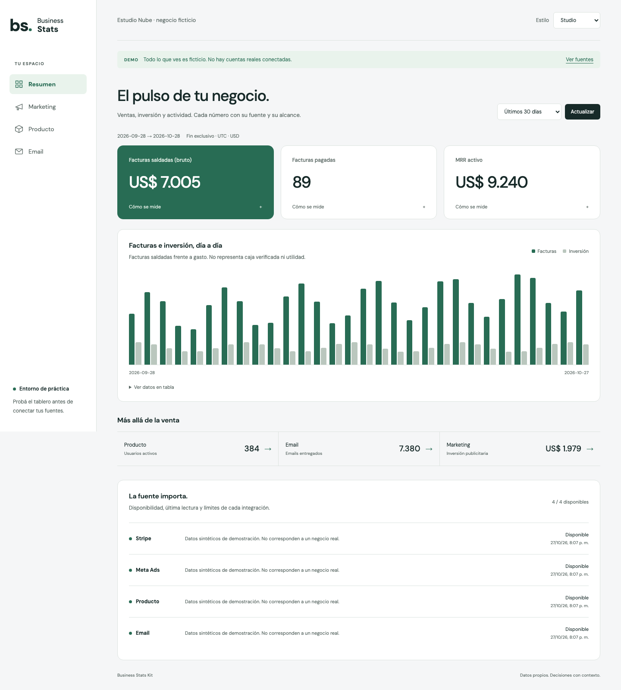

# Business Stats Kit

Un dashboard privado para entender ventas, marketing, producto y email de tu negocio. Incluye una demo ficticia, tres apariencias y un recorrido guiado para Claude Code o Codex. Cada alumno usa su propia instalación y sus propias credenciales.



[Editorial](docs/images/editorial.png) · [Terminal](docs/images/terminal.png) · [Pruebas y límites](docs/verification.md)

## Probar la demo

Necesitás Git, Node.js 22.22 o superior compatible (también podés usar Node.js 24) y npm. Creá tu copia de este repositorio y, desde su carpeta:

```bash
npm ci
cp .env.example .env.local
npm run dev
```

Abrí [http://localhost:4321](http://localhost:4321). `.env.example` selecciona `APP_MODE=demo`: los datos son sintéticos y no se consulta ninguna cuenta real. Podés cambiar entre Studio, Editorial y Terminal sin cambiar las métricas.

Si el cliente Git no conserva enlaces simbólicos, Claude puede leer las skills directamente desde `.agents/skills/`. No hace falta instalar nada globalmente.

## Pedile al agente que te guíe

Abrí esta carpeta en Claude Code o Codex y escribí:

> Leé AGENTS.md y usá la skill stats-onboarding. Quiero adaptar este dashboard a mi negocio. Ayudame a definir las métricas y conectar mis fuentes, sin pedirme claves en el chat.

Skills incluidas:

- `stats-onboarding`: define el negocio y prepara su configuración.
- `stats-connect-sources`: conecta/adapta fuentes y concilia sus números.
- `stats-security`: comprueba acceso privado y prepara o verifica un despliegue.

La fuente común es `.agents/skills/`; `.claude/skills/` la enlaza para Claude Code. Las instrucciones están en español y no autorizan al agente a cobrar, enviar emails ni cambiar campañas.

## Qué incluye hoy

| Parte | Implementación | Límite relevante |
|---|---|---|
| Interfaz | Resumen, Marketing, Producto y Email; tres estilos. | Los datos de la demo son ficticios. |
| Acceso real | Dueño único, contraseña y passkey, estado durable en Postgres. | Sin equipos, registro público ni segunda passkey independiente desde el panel. |
| Stripe | Importes de facturas saldadas del catálogo; snapshot MRR de precio fijo. | Puede incluir pagos externos/créditos: no es caja verificada. Sin pagos sin factura, reembolsos/comisiones ni descuentos en MRR. |
| Meta | Lectura por cuentas y campañas configuradas. | Moneda/zona deben coincidir; requiere acceso API de la cuenta. |
| Producto | Eventos de valor y fallos por importación JSON o sincronización manual desde PostHog. | PostHog requiere eventos canónicos; otros proveedores necesitan un adaptador. |
| Email | Entregas y clics por mensaje mediante importación JSON. | Sin envío de emails, aperturas ni atribución de ventas. |
| Guías | Configuración, seguridad, métricas, clase e investigación. | No reemplazan la conciliación con tus cuentas ni una auditoría externa. |

## Pasar a tus datos

1. Completá `business.config.ts`: nombre, moneda, zona horaria, productos Stripe y scope de campañas Meta.
2. Prepará un Postgres dedicado. Configurá `DATABASE_URL`, `APP_MODE=live` y `APP_ORIGIN` del lado servidor.
3. Seguí [la guía de acceso](docs/security.md): `npm run auth:setup`, alta inicial con token privado y registro de passkey en `/login`.
4. Conectá una fuente por vez con [la guía de integraciones](docs/integrations.md). Producto/email usan `db/analytics.sql` y `npm run data:import -- archivo.json`.
5. Conciliá un día cerrado contra el origen y completá [las pruebas previas a publicar](docs/security.md#antes-y-después-de-publicar).

No cambies a modo real solo para quitar la etiqueta de demo. Sin configuración válida se bloquea. Guardá las claves en `.env.local` o en el gestor de secretos del hosting; nunca en archivos públicos, prompts o commits.

## Verificar

```bash
npm test
npm run typecheck
npm run build
```

Las pruebas PostgreSQL opcionales requieren bases desechables: `AUTH_TEST_DATABASE_URL` debe terminar en `_auth_test`; `TEST_DATABASE_URL`, usada por las pruebas de importación, debe terminar en `_import_test`. Leé esos tests antes de ejecutarlos: crean/modifican y eliminan esquemas de prueba. Si las variables no están configuradas, se omiten; eso no es una verificación de tu base real.

El build no prueba el login en tu teléfono ni los permisos de tus cuentas. La verificación final requiere entrar con tu autenticador en el origen definitivo y confirmar que la API rechaza pedidos sin sesión.

## Mapa del proyecto

- `business.config.ts`: alcance del negocio, sin secretos.
- `app/`: interfaz y rutas HTTP.
- `lib/auth/` + `sql/auth.sql`: acceso y persistencia privada.
- `lib/connectors.ts`: consultas de lectura a proveedores.
- `db/analytics.sql` + `scripts/import-data.ts`: contrato de eventos importados.
- `tests/`: casos de seguridad y métricas.
- [Clase paso a paso](docs/class.md), [definiciones de métricas](docs/metrics.md), [integraciones](docs/integrations.md), [seguridad y recuperación](docs/security.md), [referencias evaluadas](docs/research.md).

## Publicación y mantenimiento

El repositorio contiene código, no una cuenta de hosting ni una base preconfiguradas. Elegí un dominio HTTPS estable, almacená secretos solo en el servidor, verificá permisos y probá el deployment real. El proceso estándar de producción es `npm run build` y `npm start`; adaptá la escucha de red al hosting elegido sin abrir el servidor de desarrollo a internet.

Mantené dependencias, backups, revisión de permisos y conciliaciones cuando cambien productos o proveedores. No se promete seguridad absoluta ni una réplica completa de una plataforma de atribución comercial.

Licencia del código propio: [MIT](LICENSE). Los repos externos se investigaron como referencias; no se copiaron sus templates ni skills. Si incorporás componentes ajenos, conservá sus licencias.
