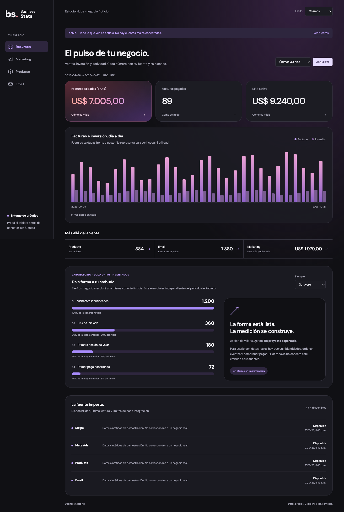
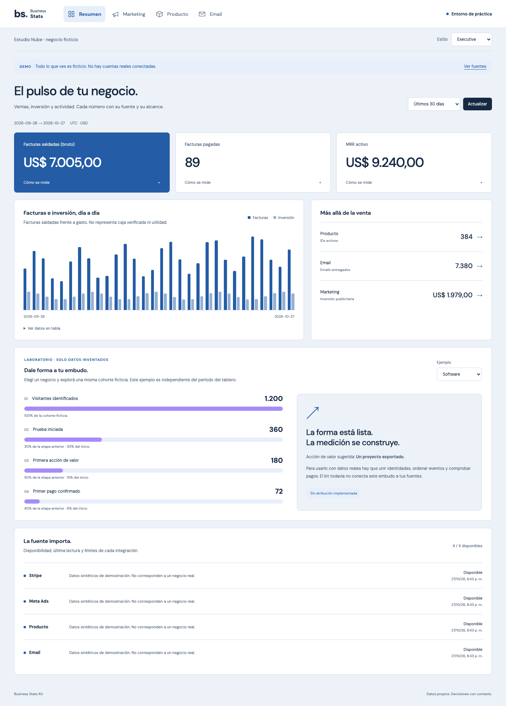

# Elegir y adaptar un diseño

Los cinco estilos son código funcional de la misma app: elegilos en **Estilo**, arriba del tablero. Se guardan en este navegador cuando el almacenamiento está disponible. Ninguno cambia fórmulas, autenticación ni fuentes.

| Estilo | Cuándo elegirlo | Qué cambia |
|---|---|---|
| **Cosmos** | Querés una estética similar al tablero de Claudio. | Grafito, vidrio, tarjetas amplias y cifra principal en degradé rojo/violeta. Es una reinterpretación visual sin cuentas, datos ni código de conectores del negocio original. |
| **Executive** | Preferís revisar todo rápido en una pantalla grande. | Navegación superior, tarjetas compactas, gráfico y resumen lado a lado. En móvil se apila para conservar legibilidad. |
| **Studio** | Querés una base clara y discreta. | Verde, superficies blancas y navegación lateral. |
| **Editorial** | Preferís una presentación de informe. | Papel, serif y líneas rectas. |
| **Terminal** | Buscás alta densidad y una estética técnica. | Oscuro, tipografía monoespaciada y acentos verdes. |

## Galería con datos inventados

Las capturas son de Estudio Nube, un negocio ficticio. No representan la facturación ni la operación de Claudio.

## Tres ejemplos de embudo

En **Resumen**, únicamente en modo demo, el laboratorio permite elegir Software, Curso/PDF o Servicio. Cada ejemplo tiene cuatro etapas y porcentajes calculados sobre una cohorte inventada. Es una muestra de diseño **independiente del período seleccionado**; no usa ni modifica las métricas principales. No aparece en modo real.

Para convertirlo en una medición propia, primero hay que definir identidad, orden, ventana, fuente y exclusiones. Las etapas deben referirse a una misma cohorte identificada. No dividas clics de Meta por pagos de Stripe para inventar una conversión: un clic no es una persona y un pago puede provenir de otra visita. El kit no trae implementada la unión anuncio→visita→pago.

En cursos, descargar un PDF no demuestra que lo hayan leído. En servicios, el pago debe confirmarse en la fuente de cobros; una propuesta aceptada no equivale a dinero recibido.

## Archivos para modificar

- `app/globals.css`: tokens de color y reglas `.theme-cosmos`, `.theme-executive`, etc.
- `app/Dashboard.tsx`: estructura común, selector de estilos, filtros y tarjetas. Mantener todos los estados de error, falta de datos y cobertura.
- `app/DemoFunnel.tsx`: laboratorio visual sintético, separado de las fuentes reales.
- `lib/contracts.ts`: significado y formato de datos; cambiar el diseño no exige cambiar este contrato.

Prompt de ejemplo:

> Quiero usar Cosmos como base, con mi marca y colores. Leé AGENTS.md y docs/designs.md. Trabajá primero en demo. Conservá etiquetas, fuentes, cobertura, estados sin datos, autenticación y definiciones. Probá escritorio y móvil, teclado, contraste, errores y valores largos. No conviertas los ejemplos ficticios en datos live ni agregues un conector que todavía no existe.

Al revisar una modificación, elegí los cinco estilos, cambiá secciones y períodos, abrí “Cómo se mide”, probá una fuente no disponible y verificá que no haya scroll horizontal en móvil. Una captura bonita no demuestra que la API esté protegida.
